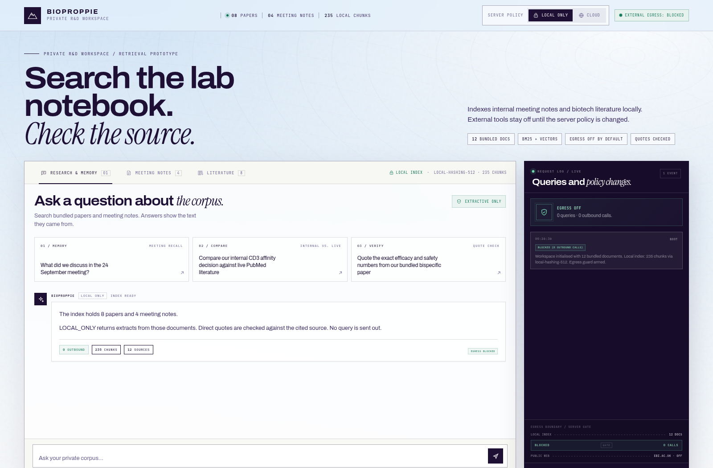

# BioProppie

A private biotech research workspace prototype. It searches bundled papers and internal meeting notes, shows the exact evidence behind each answer, and keeps external tools off until the server policy is changed.



## What it does

- LOCAL_ONLY by default: no outbound calls; answers are extracts with checked quotes.
- CLOUD_APPROVED: adds live Europe PMC results and a grounded synthesis. Works without API keys; optional OpenAI/Anthropic keys enable LLM synthesis.
- Hybrid retrieval: BM25 plus local hash vectors. No model download or GPU.
- Exact / close / unverified badges produced by deterministic quote verification.
- Query log tab records queries, policy changes, egress status, sources, and verification counts.

## Run

Python 3.11+:

```bash
uv venv --python 3.11 .venv
uv pip install --python .venv/bin/python -r python/requirements.txt
.venv/bin/uvicorn app:app --host 127.0.0.1 --port 8000
```

Open `http://127.0.0.1:8000`.

Tests:

```bash
.venv/bin/python -m pytest -q
```

## Demo prompts

1. `What did we discuss in the 24 September meeting?`
2. `Compare our internal CD3 affinity decision against live PubMed literature`
3. `Quote the exact efficacy and safety numbers from our bundled bispecific paper`

Use the header toggle to switch between LOCAL_ONLY and CLOUD_APPROVED.

## Data

`data/corpus.json` contains 8 real Europe PMC abstracts and 4 fictional internal meeting notes, stored in one schema so search, citations, and verification work uniformly.
